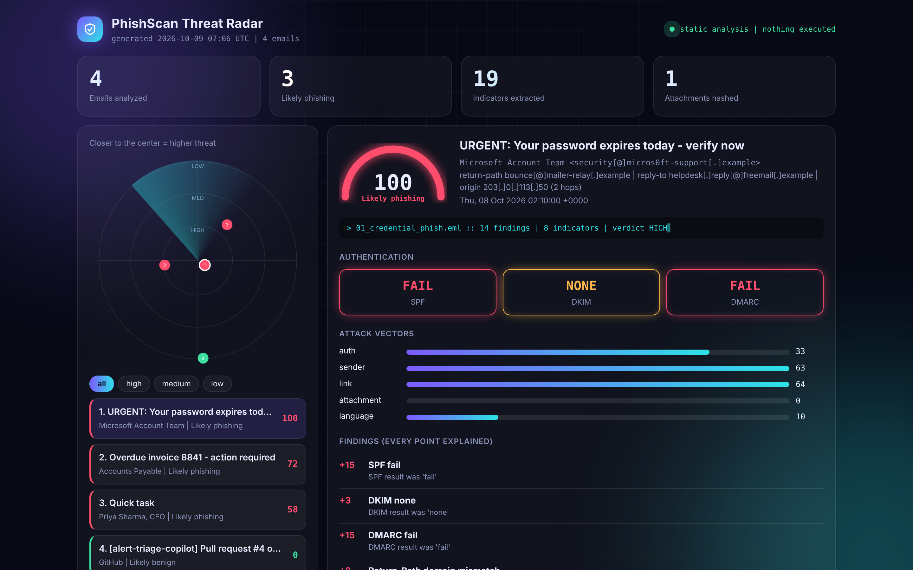
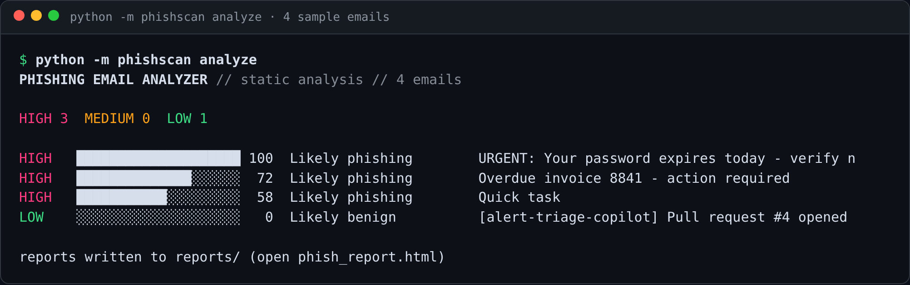
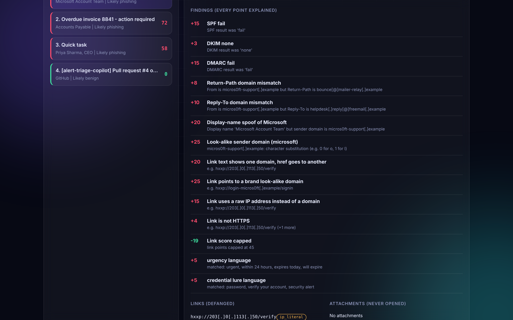
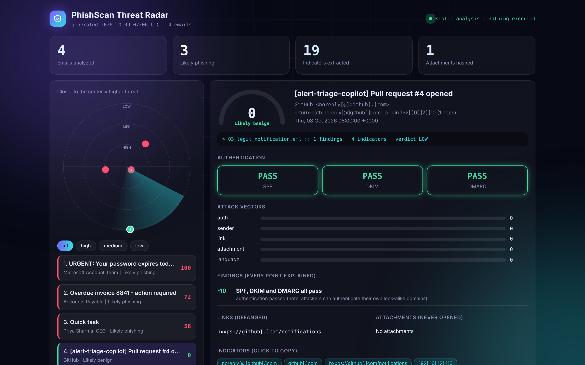
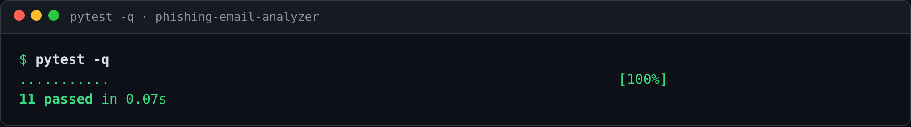

# Phishing Email Analyzer

> Drop in a `.eml` file, get an explained verdict, defanged indicators and next steps in under a second.
> Static analysis only: nothing is opened, visited or executed.




## The dashboard: Threat Radar

`phish_report.html` is a single self-contained file (no server, no internet, no dependencies):

- **Radar:** every email is a blip. The closer to the center, the higher the threat. A sweep rotates over it, and clicking a blip (or using the arrow keys) selects the email.
- **Animated scan:** a scan line crosses the panel, the risk gauge fills, the score counts up and a terminal strip types the verdict.
- **Attack-vector bars:** authentication, sender, link, attachment and language, each with the points behind it.
- **Auth tiles, findings with reasons, defanged links, attachment hashes, MITRE chips.**
- **Click-to-copy indicators** and a **tick-off action checklist** for the response.
- Filters, keyboard navigation, mobile layout, and `prefers-reduced-motion` support.

Safe by construction: emails are embedded as JSON and rendered with `textContent` only, so a hostile
subject line cannot inject script (tested). The earlier list-style report is still available as
`report.to_html_classic`.

## The problem

Phishing is the most common ticket in a SOC queue. Every one needs the same manual routine: read the headers,
check SPF/DKIM/DMARC, hover over links, hash the attachment, decide, and write it up. This tool automates that
first pass and shows its reasoning.

## What it checks

| Layer | Checks |
|---|---|
| **Authentication** | SPF / DKIM / DMARC results from `Authentication-Results` and `Received-SPF`; optional DNS check that the sender publishes SPF and DMARC (`--dns`) |
| **Sender** | Return-Path and Reply-To domain mismatch, display-name brand spoofing, address hidden in display name, executive title on a free-mail account (BEC), look-alike domains |
| **Look-alikes** | Leetspeak/homoglyph (`micros0ft`), typosquats, brand used in unrelated or sub-domains, punycode IDN tricks. Real brand domains (`login.microsoftonline.com`) are not flagged |
| **Links** | href vs. visible text mismatch, raw IP links, `@` host tricks, shorteners, punycode, risky TLDs, deep subdomains, plain HTTP |
| **Attachments** | Executables/scripts, double extensions (`invoice.pdf.exe`), macro Office files, HTML/SVG smuggling, archives. Hashed with SHA-256, never opened |
| **Language** | Urgency, credential lures, payment lures, BEC phrases |
| **Routing** | Hop count and originating IP from the `Received` chain |

## Quickstart (no network needed)

```bash
git clone https://github.com/NChiranjeevi6/phishing-email-analyzer.git
cd phishing-email-analyzer
python -m venv .venv
source .venv/bin/activate        # Windows: .venv\Scripts\activate
pip install -r requirements.txt
python -m phishscan analyze                      # analyzes samples/
python -m phishscan analyze path/to/mail.eml     # one file
python -m phishscan analyze inbox_export/ --dns  # a folder, plus SPF/DMARC record check
open reports/phish_report.html
```

Outputs: terminal summary, `phish_report.html` (dashboard), `.md` (paste into a ticket), `.json` (feed a SOAR).

## Architecture

```
 .eml --> parser.py --> analyzer.py --------------------> report.py --> html / md / json / terminal
          headers,      auth | sender | links |            escape + defang everything
          bodies,       attachments | language |
          attachments   look-alike engine -> findings (points + reason) -> score -> verdict -> actions
```

## Scoring

Each finding adds points with a written reason; the verdict is the clamped sum. Nothing is a black box.

| Score | Verdict | Meaning |
|---|---|---|
| 55-100 | HIGH | Likely phishing: quarantine, purge, block, hunt |
| 25-54 | MEDIUM | Suspicious: verify out-of-band before acting |
| 0-24 | LOW | Likely benign |

Example weights: SPF fail +15, DMARC fail +15, executive title on free mail +25, look-alike domain +25,
link-text mismatch +20, executable attachment +25. All three auth checks passing gives -10, but **only if
there is no look-alike or spoof finding**, because attackers can authenticate their own look-alike domains.

## Demo results (synthetic samples)

| Sample | Score | Verdict | Why |
|---|---|---|---|
| Credential phish | 100 | HIGH | SPF/DMARC fail, Microsoft display-name spoof, `micros0ft` look-alike, link text vs. IP mismatch |
| Invoice with `.pdf.exe` | 72 | HIGH | Double extension, executable attachment, return-path mismatch, payment urgency |
| CEO gift-card request | 58 | HIGH | Exec title on free mail, reply-to switch, BEC phrasing (no links, no malware) |
| GitHub notification | 0 | LOW | All auth passes, brand-owned domain, clean link |

## Proof it works

Everything below was produced by running the tool on the four bundled synthetic emails.

**Terminal output.** Three phishing emails are rated HIGH and the legitimate GitHub notification is rated LOW (0).



**Findings, each with its points and reason.** The credential phish earns its 100 from SPF/DMARC failures, a
`micros0ft` look-alike domain, a Microsoft display-name spoof and a link whose text does not match its destination.
Every link and address is defanged.



**No false alarm on legitimate mail.** The GitHub notification passes SPF, DKIM and DMARC, comes from a brand-owned
domain, and scores 0.



**Tests.**



I also ran it on extra emails that are not in the repo. A genuine Microsoft security email scored 0 (LOW), a PayPal
look-alike (`paypa1-secure.top`) scored 100 (HIGH), and a plain internal email scored 0 (LOW).

## MITRE ATT&CK mapping

`T1566.001` spearphishing attachment, `T1566.002` spearphishing link, `T1656` impersonation,
`T1583.001` acquire look-alike domains. Shown per finding and aggregated per email.

## Tests

```bash
pytest -q    # 11 tests
```

Covers: sample verdicts, no false positives on real brand domains, look-alike detection, URL and attachment
flags, auth parsing, score integrity, "passing auth does not whitewash a look-alike", and escaping/defanging
of hostile email content.

## Limitations (honest ones)

- Heuristics, not a replacement for a secure email gateway. Expect false positives and false negatives.
- A corrupt or empty `.eml` file does not crash a batch, but it is currently scored LOW ("Likely benign") instead of being skipped. Treat a LOW result with a blank subject and sender as "could not parse", not "safe".
- The brand list is small and editable in `analyzer.py`. Substring matching can flag benign domains that happen to contain a brand name.
- No reputation lookups or sandboxing yet; hashes and URLs are produced so you can submit them yourself.
- Header trust: the first `Authentication-Results` is assumed to come from your own gateway.
- `--dns` needs `dnspython` and a network, and has not been tested against a wide range of real domains.

## Roadmap

- [ ] VirusTotal hash and URL reputation (reuse the enrichment module from Alert Triage Copilot)
- [ ] `.msg` support and QR-code (quishing) detection
- [ ] Export indicators as STIX / MISP
- [ ] Batch mode that clusters campaigns by shared infrastructure

## Skills demonstrated

Email header forensics, SPF/DKIM/DMARC, BEC and brand-impersonation detection, IOC extraction and defanging,
MITRE ATT&CK mapping, safe handling of hostile input, Python, unit testing, CI.

## Responsible use

Defensive tool with synthetic samples. See [SECURITY.md](SECURITY.md). MIT licensed.
